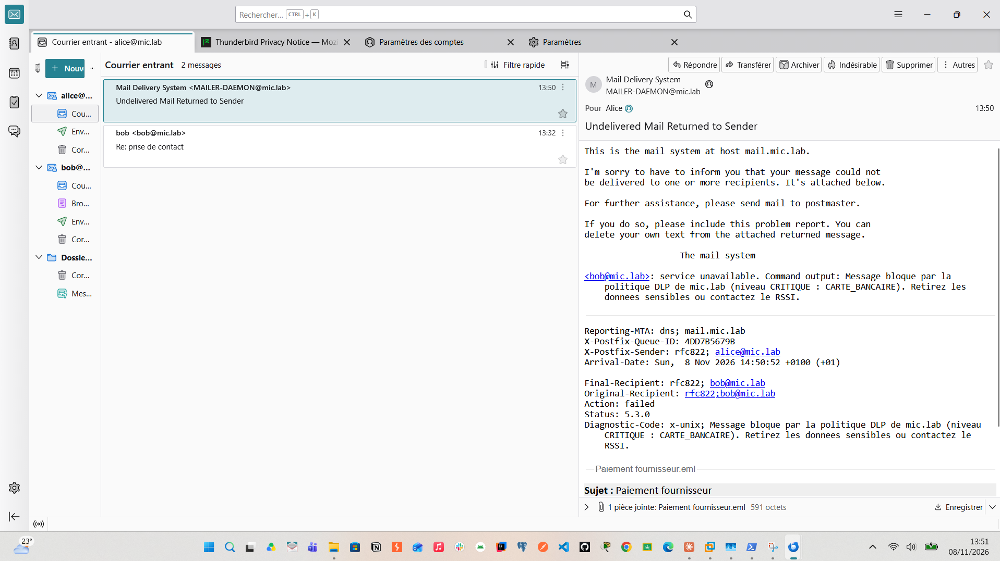
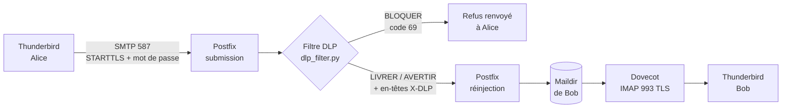
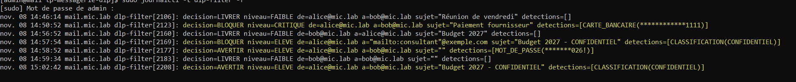
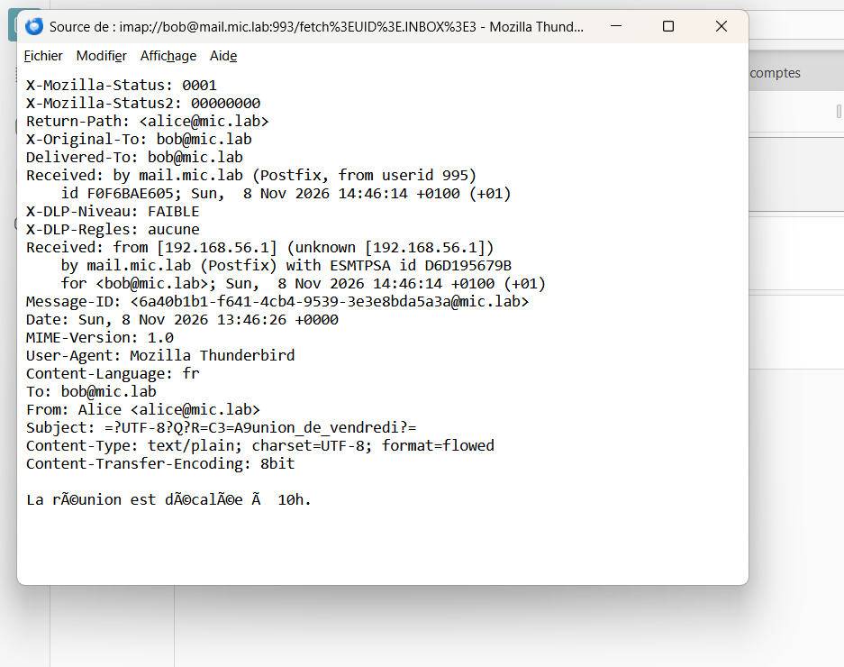
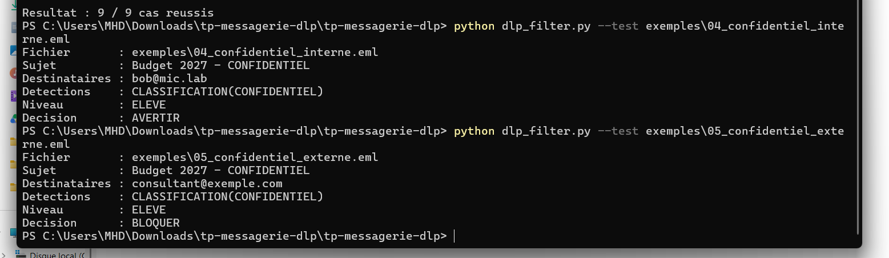

# Serveur de messagerie AlmaLinux 9 avec DLP en Python

> **EN —** Self-hosted mail server lab (Postfix + Dovecot on AlmaLinux 9, VMware) with TLS, SASL authentication, a home-made PKI and a **custom Python Data Loss Prevention filter** that inspects every outgoing email and delivers, warns or blocks it depending on its content (credit cards, IBANs, private keys, passwords, classified documents) **and** its recipient.

Projet personnel réalisé pendant mon **Master 1 Ingénierie de la cybersécurité** (Université Mundiapolis, Casablanca), en lien avec le cours d'introduction à la sécurité informatique (DLP réseau, pattern matching, protection des données en transit).


*Alice tente d'envoyer un numéro de carte bancaire : le mail est refusé et elle reçoit l'explication de la politique DLP.*

---

## Ce que fait le projet

Une fausse entreprise, **mic.lab**, avec deux employés, **Alice** et **Bob**. Chaque mail envoyé par un employé passe par un filtre DLP **avant** de quitter le serveur. Le filtre :

1. lit le sujet, le corps et les pièces jointes du mail ;
2. cherche des données sensibles avec des expressions régulières, vérifiées par des clés de contrôle (algorithme de **Luhn** pour les cartes, **modulo 97** pour les IBAN) pour éviter les faux positifs ;
3. décide selon le **niveau de risque** et le **destinataire** (interne `@mic.lab` ou externe) ;
4. journalise la décision **sans jamais écrire la donnée en clair** (masquage `************1111`).

| Donnée détectée | Méthode | Niveau | Destinataire interne | Destinataire externe |
|---|---|---|---|---|
| Carte bancaire | regex + Luhn | CRITIQUE | bloqué | bloqué |
| Clé privée (texte ou pièce jointe `.key`, `.pem`, `.pfx`, `.p12`, `.kdbx`) | regex + extension | CRITIQUE | bloqué | bloqué |
| IBAN | regex + modulo 97 (ISO 13616) | ÉLEVÉ | averti | bloqué |
| Mot de passe en clair | regex | ÉLEVÉ | averti | bloqué |
| « CONFIDENTIEL », « DIFFUSION RESTREINTE » | regex | ÉLEVÉ | averti | bloqué |
| Numéro de CIN marocaine | regex | MOYEN | averti | averti |

- **Bloqué** : Postfix refuse le mail (code 5.3.0) et l'expéditeur reçoit un message qui explique pourquoi.
- **Averti** : le mail est livré avec les en-têtes `X-DLP-Niveau` et `X-DLP-Regles`.

## Architecture



| Élément | Rôle |
|---|---|
| **AlmaLinux 9.7** (VMware Workstation) | serveur `mail.mic.lab`, 2 Go RAM, 2 cartes réseau (NAT + host-only) |
| **Postfix 3.5** | MTA : port 25 (serveurs) et port 587 (utilisateurs, TLS + SASL obligatoires) |
| **Dovecot 2.3** | IMAP chiffré (993) et vérification des mots de passe pour Postfix (SASL) |
| **PKI maison** | CA « MIC LAB Root CA » qui signe le certificat du serveur (avec SAN) |
| **dlp_filter.py** | filtre Python 3.9, sans dépendance, lancé par Postfix via un service `pipe` |
| **Thunderbird** (Windows) | client mail d'Alice et de Bob |

## Résultats

Les 9 scénarios passent, en test automatique comme en conditions réelles :

| # | Scénario | Résultat |
|---|---|---|
| 1 | Mail normal Alice → Bob | ✅ livré, `X-DLP-Niveau: FAIBLE` |
| 2 | Carte bancaire `4111 1111 1111 1111` | ✅ bloqué (CRITIQUE) |
| 3 | IBAN marocain vers une adresse externe | ✅ bloqué (ÉLEVÉ, externe) |
| 4 | « CONFIDENTIEL » vers Bob | ✅ livré avec avertissement |
| 5 | « CONFIDENTIEL » vers un consultant externe | ✅ bloqué |
| 6 | Numéro de CIN | ✅ livré avec avertissement (MOYEN) |
| 7 | Mot de passe en clair en interne | ✅ livré avec avertissement |
| 8 | Pièce jointe `serveur.key` | ✅ bloqué (CRITIQUE) |
| 9 | Numéro de commande `1234 5678 9012 3456` | ✅ livré : Luhn invalide, pas de faux positif |

**Le journal de la DLP** (`journalctl -t dlp-filter`) : les trois décisions, les numéros masqués, et la politique contextuelle (même sujet « CONFIDENTIEL » : averti en interne, bloqué vers l'extérieur) :



**Les en-têtes d'un mail livré** : on lit le trajet de bas en haut. `ESMTPSA` = envoi chiffré et authentifié, puis l'analyse DLP, puis la réinjection par le compte sans privilèges `dlpfilter` (uid 995) :



**Tests automatiques** (même résultat sous Windows et sous Linux) :



## Bonnes pratiques de sécurité appliquées

| Principe | Mise en œuvre |
|---|---|
| Chiffrement des données en transit | TLS obligatoire sur 587 (`encrypt`) et 993 (`ssl = required`), mot de passe refusé hors tunnel |
| PKI | CA dédiée, certificat serveur `CA:FALSE` avec SAN, clé privée en `600` |
| Moindre privilège | le filtre tourne sous `dlpfilter` (pas de shell, pas de mot de passe) |
| Fail-closed | si le filtre plante, le mail reste en file d'attente (code 75) au lieu de passer sans contrôle |
| Pas de fuite dans les logs | les données détectées sont masquées dans le journal |
| Deny by default | firewalld n'ouvre que `ssh`, `smtp`, `smtp-submission`, `imaps` |
| Traçabilité | chaque décision est journalisée : qui, à qui, quoi, pourquoi, quelle décision |

## Problèmes rencontrés et solutions

| Symptôme | Diagnostic (journal) | Solution |
|---|---|---|
| Thunderbird ne se connecte pas | `dovecot: SSL_accept() failed: ssl/tls alert bad certificate: SSL alert number 42` → le **client** rejette le certificat | Les logiciels Mozilla refusent un certificat auto-signé `CA:TRUE` sans SAN : création d'une **CA du labo** qui signe un certificat serveur `CA:FALSE` + `subjectAltName`, puis import de la CA dans Thunderbird ([config/pki](config/pki/creer-pki.sh)) |
| « Ajouter une exception » ne récupère rien | aucune ligne dans le journal Dovecot : la demande n'atteint pas le serveur | contourner la fenêtre ; la solution PKI ci-dessus rend l'exception inutile |
| Authentification refusée | `pam_unix(dovecot:auth): authentication failure ... user=alice` (12 essais en 151 s) | mot de passe redéfini avec `passwd`, puis test avec `su - alice` ; ce motif de log est celui d'une attaque par force brute |
| Mise à jour `dnf` bloquée | `linux-firmware ... all mirrors were already tried` | paquet inutile dans une VM : `dnf update --exclude=linux-firmware*` |

## Contenu du dépôt

```
tp-messagerie-dlp/
├── dlp_filter.py              le filtre DLP (Python 3.9+, aucune dépendance)
├── tests_dlp.py               9 tests automatiques
├── exemples/                  9 mails de test (.eml), données fictives
├── config/
│   ├── postfix/main-cf.sh     réglages main.cf (postconf)
│   ├── postfix/master.cf.ajouts   port 587 + service DLP
│   ├── dovecot/99-mic-lab.conf    configuration Dovecot complète
│   └── pki/creer-pki.sh       création de la CA et du certificat serveur
└── docs/
    ├── GUIDE.md               guide d'installation pas à pas
    ├── TP-messagerie-DLP-Mohamed-Traore.pdf   rapport complet (26 pages)
    └── captures/              captures du labo
```

## Essayer le filtre sans serveur

Fonctionne sous Windows, Linux ou macOS avec Python 3.9+ :

```bash
python tests_dlp.py
python dlp_filter.py --test exemples/02_carte_bancaire.eml
```

Pour monter le labo complet, suivre **[docs/GUIDE.md](docs/GUIDE.md)**, ou la version PDF illustrée : **[docs/TP-messagerie-DLP-Mohamed-Traore.pdf](docs/TP-messagerie-DLP-Mohamed-Traore.pdf)** (26 pages).

## Limites connues et améliorations possibles

- Les pièces jointes **PDF, Word et ZIP** ne sont pas analysées (piste : `pdftotext`, `python-docx`).
- Les archives chiffrées passent sans analyse : il faudrait les bloquer par défaut.
- Le mail de refus renvoie le message d'origine à l'expéditeur : une **quarantaine** côté serveur serait plus propre.
- Seul le port 587 est filtré : un mail interne déposé sur le port 25 ne passe pas par la DLP.
- Ajouter **fail2ban** contre la force brute sur IMAP/SMTP, et retirer le service `cockpit` inutilisé du pare-feu.
- Ajouter SPF, DKIM et DMARC pour un vrai domaine.

## Compétences mobilisées

Administration Linux (AlmaLinux, systemd, SELinux, firewalld, nmcli) · Messagerie (SMTP, IMAP, SASL, Postfix, Dovecot) · Cryptographie appliquée (TLS, PKI, X.509, SAN) · Python (regex, `email`, `subprocess`, syslog) · Analyse de journaux · Virtualisation (VMware Workstation).

---

**Auteur :** Mohamed Traoré — Master 1 Ingénierie de la cybersécurité, Université Mundiapolis (Casablanca)
