# Guide pas à pas : serveur de messagerie AlmaLinux 9 avec DLP

Ce guide reprend exactement les étapes suivies pour monter le labo, avec les captures et les problèmes rencontrés. Durée : 4 à 6 heures.

**Matériel :** un PC Windows (8 Go de RAM ou plus), VMware Workstation Pro, l'ISO **AlmaLinux 9 minimal** (pas la 10 : la configuration de Dovecot change), Thunderbird, Python 3.

**Plan d'adressage :**

| Machine | Rôle | Adresse |
|---|---|---|
| VM `mail.mic.lab` | serveur (Postfix, Dovecot, DLP) | `192.168.56.10` (fixe), carte `ens192` sur VMnet1 |
| PC Windows | poste d'Alice et de Bob (Thunderbird) | `192.168.56.1` (carte VMnet1) |
| Carte NAT `ens160` | accès Internet de la VM (mises à jour) | DHCP VMware (`192.168.163.0/24`) |

> **Conseil :** prendre un instantané VMware à la fin de chaque partie, **VM éteinte** (`sudo poweroff`). Avec la VM allumée, VMware copie toute la RAM et la VM se fige pendant plusieurs minutes.

---

## Partie 0 : comprendre ce qu'on construit

| Dans la vraie vie | Dans le labo | Rôle |
|---|---|---|
| La personne qui écrit | Thunderbird | écrire et lire les mails |
| Le bureau de poste | Postfix | recevoir et envoyer (SMTP) |
| La boîte aux lettres | `~/Maildir` | ranger les mails reçus |
| Le guichet | Dovecot | permettre de lire la boîte (IMAP) |
| Le douanier | `dlp_filter.py` | inspecter les mails sortants |

Ports : **25** entre serveurs, **587** pour les utilisateurs qui envoient (là où se place la DLP), **993** pour lire ses mails (IMAP chiffré).

---

## Partie 1 : la VM

### 1.1 Le réseau host-only (VMnet1)

VMware → **Modifier → Éditeur de réseau virtuel → Modifier les paramètres** → VMnet1 : *Hôte uniquement*, sous-réseau `192.168.56.0`, masque `255.255.255.0`.

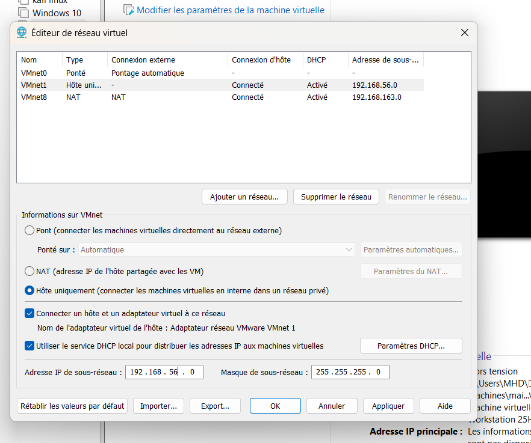

La plage DHCP va de `.128` à `.254` : l'adresse fixe du serveur (`.10`) est choisie **hors de cette plage** pour éviter tout conflit.

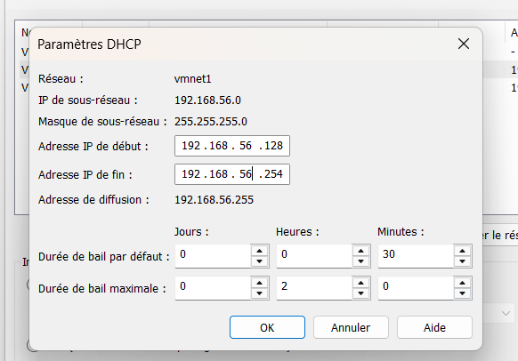

### 1.2 Créer la VM

**Fichier → Nouvelle machine virtuelle → Typique**, ISO AlmaLinux 9 minimal, nom `mail-mic-lab`, disque 20 Go. Dans **Personnaliser le matériel** : 2 Go de RAM, 2 processeurs, carte réseau 1 en **NAT**, **ajouter** une carte réseau 2 en **Personnalisé : VMnet1**, supprimer la carte son.

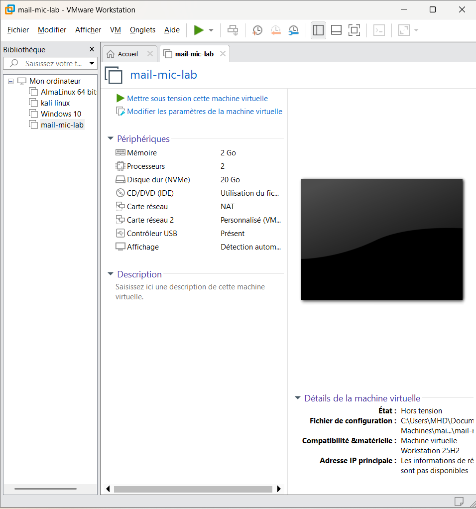

### 1.3 Installer AlmaLinux

Clavier français, fuseau Afrique/Casablanca, **Installation minimale** (pas d'interface graphique), partitionnement automatique, compte root désactivé, utilisateur `admin` administrateur. Désactiver **KDUMP** (il réserve de la RAM inutilement).

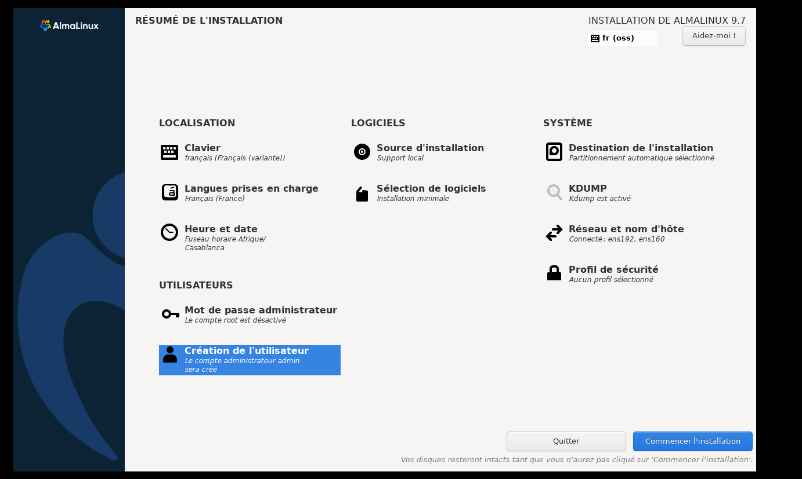

Dans **Réseau et nom d'hôte** : activer les 2 cartes et saisir le nom d'hôte `mail.mic.lab` dans le champ du bas, puis **Appliquer**.

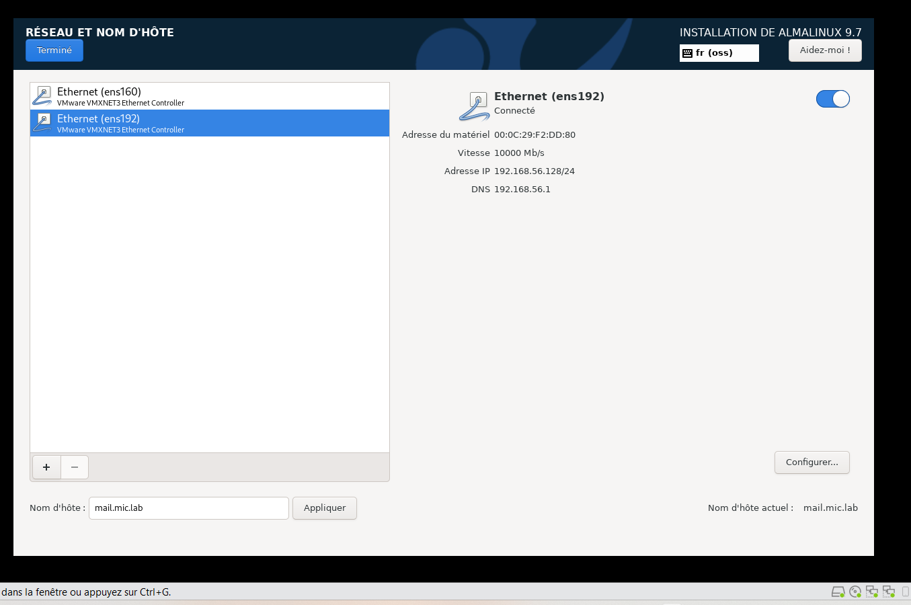

### 1.4 Adresse fixe et nom d'hôte

Depuis Windows, se connecter en SSH (le copier-coller évite les fautes de frappe) :

```powershell
ssh admin@192.168.56.128
```

```bash
sudo nmcli con mod ens192 ipv4.method manual ipv4.addresses 192.168.56.10/24
sudo nmcli con up ens192          # la session SSH se coupe : c'est normal
```

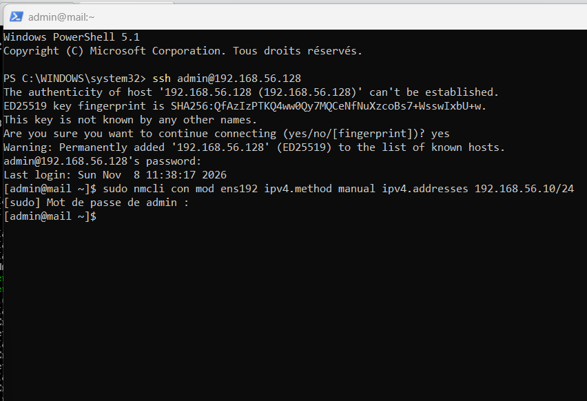

Se reconnecter sur la nouvelle adresse, puis :

```bash
echo "192.168.56.10 mail.mic.lab mail" | sudo tee -a /etc/hosts
hostname
ip a show ens192
cat /etc/hosts
```

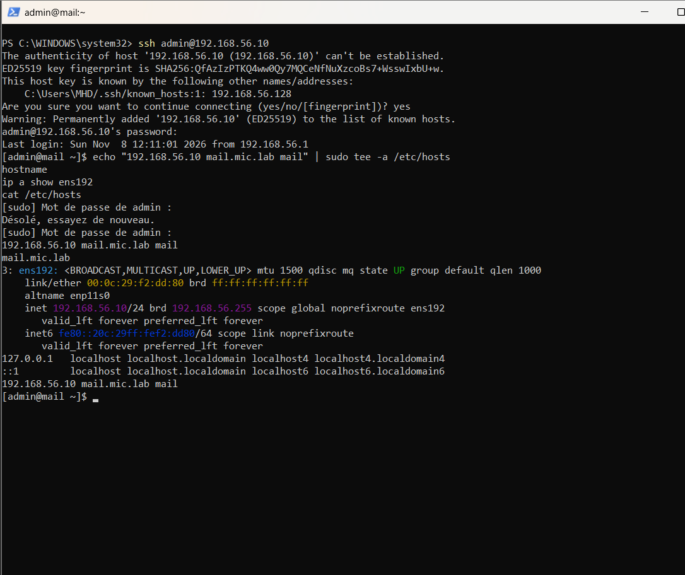

L'empreinte SSH affichée est la même pour `.128` et `.10` : SSH confirme que c'est le même serveur.

> **Piège :** quand une commande commence par `sudo`, la coller **seule**. Sinon, la ligne collée suivante est lue comme le mot de passe.

### 1.5 Windows connaît le serveur

Dans PowerShell **administrateur** :

```powershell
Add-Content -Path C:\Windows\System32\drivers\etc\hosts -Value "`r`n192.168.56.10 mail.mic.lab"
ipconfig /flushdns
ping mail.mic.lab
```

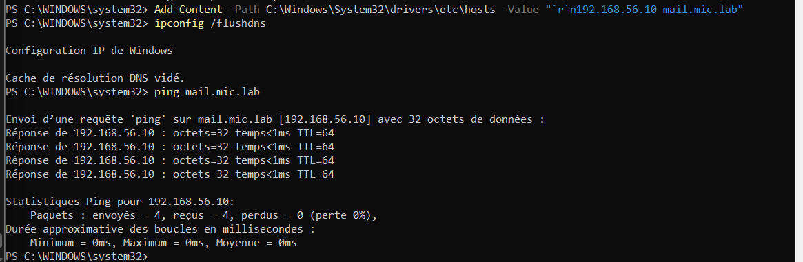

`TTL=64` : la réponse vient d'une machine Linux (Windows répond avec 128).

### 1.6 Mises à jour et paquets

```bash
echo "max_parallel_downloads=10" | sudo tee -a /etc/dnf/dnf.conf
echo "fastestmirror=True" | sudo tee -a /etc/dnf/dnf.conf
sudo dnf -y update --exclude=linux-firmware*
sudo reboot
```

`linux-firmware` (pilotes de matériel physique) est inutile dans une VM, et son téléchargement échouait sur tous les miroirs.

```bash
sudo dnf -y install postfix dovecot openssl s-nail tar
rpm -q postfix dovecot s-nail
```

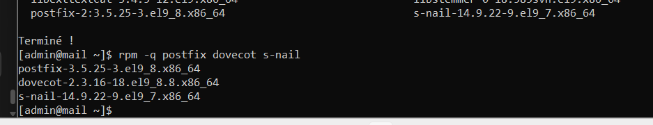

---

## Partie 2 : Postfix

### 2.1 La PKI du labo

Thunderbird refuse un certificat auto-signé simple (voir [Dépannage](#dépannage)). On crée donc une autorité de certification qui signe le certificat du serveur : script complet dans [`config/pki/creer-pki.sh`](../config/pki/creer-pki.sh).

```bash
bash creer-pki.sh       # ou les commandes une par une
```

Résultat attendu de la vérification :

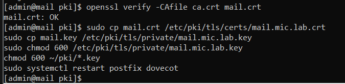

> `ca.key` est la clé la plus sensible du labo : avec elle, on peut fabriquer de faux certificats. Elle reste dans `~/pki` en `600` et n'est **jamais** copiée ailleurs ni publiée.

### 2.2 main.cf

Commandes dans [`config/postfix/main-cf.sh`](../config/postfix/main-cf.sh). Taper d'abord `sudo -v` pour ne donner le mot de passe qu'une fois, puis coller le bloc.

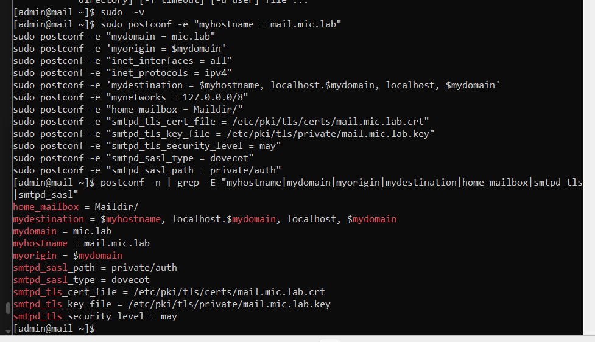

Les lignes contenant `$` sont entre guillemets **simples**, sinon le shell remplace `$mydomain` par du vide.

### 2.3 Le port 587

Ajouter le bloc `submission` de [`config/postfix/master.cf.ajouts`](../config/postfix/master.cf.ajouts) à la fin de `/etc/postfix/master.cf`, **sans** la ligne `content_filter` pour l'instant :

```bash
sudo postfix check
sudo systemctl enable --now postfix
sudo ss -ltnp | grep -E ':25 |:587 '
```

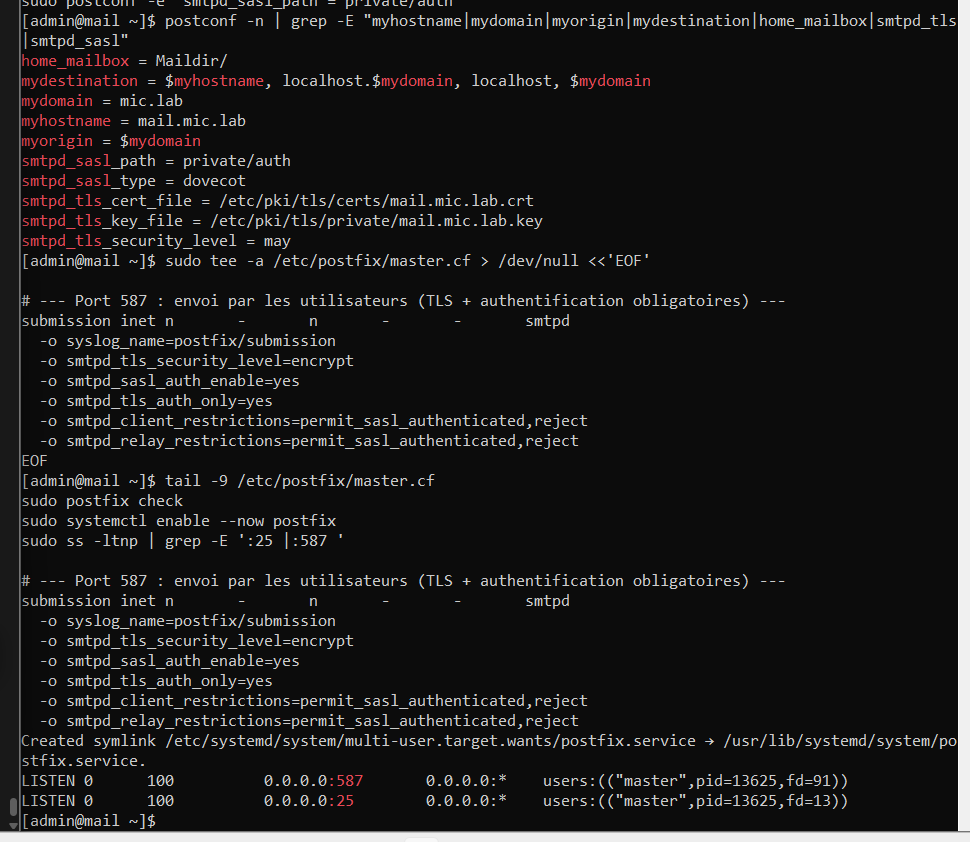

---

## Partie 3 : Dovecot

Toute la configuration est dans un seul fichier, [`config/dovecot/99-mic-lab.conf`](../config/dovecot/99-mic-lab.conf), à copier dans `/etc/dovecot/conf.d/`. Dovecot lit ce dossier par ordre alphabétique : un fichier `99-` passe en dernier et remplace les valeurs par défaut, sans toucher aux fichiers d'origine.

```bash
sudo doveconf -n | grep -E "protocols|mail_location|ssl|auth_mechanisms|private/auth"
sudo systemctl enable --now dovecot
sudo ls -l /var/spool/postfix/private/auth
sudo ss -ltnp | grep ':993 '
```

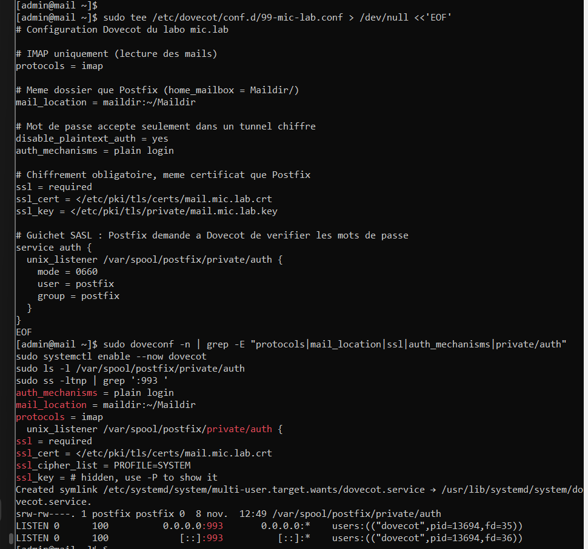

`srw-rw---- postfix postfix` : le `s` indique un socket, le « guichet » par lequel Postfix demande à Dovecot de vérifier un mot de passe. Dovecot masque lui-même le chemin de la clé (`ssl_key = # hidden`).

---

## Partie 4 : comptes, pare-feu, Thunderbird

### 4.1 Comptes et pare-feu

```bash
sudo useradd -m alice && sudo passwd alice
sudo useradd -m bob && sudo passwd bob

sudo firewall-cmd --permanent --add-service=smtp --add-service=smtp-submission --add-service=imaps
sudo firewall-cmd --reload
sudo firewall-cmd --list-services
```

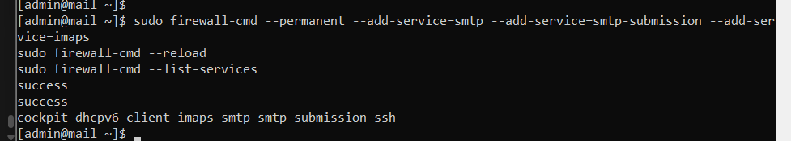

AlmaLinux applique une politique de mots de passe (`pam_pwquality` : 8 caractères minimum, pas le nom de l'utilisateur). Seul root peut passer outre.

### 4.2 Premier mail en ligne de commande

```bash
echo "Bonjour Bob, premier mail du serveur mic.lab" | mail -s "Test 1" bob@mic.lab
sudo journalctl -u postfix --since "5 min ago" | grep bob
sudo sh -c 'cat /home/bob/Maildir/new/*'
```

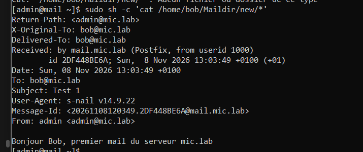

`sudo sh -c '...'` est nécessaire : l'étoile `*` est interprétée par le shell de l'utilisateur admin, qui n'a pas le droit de lire le dossier de Bob.

| Champ du journal | Sens |
|---|---|
| `2DF448BE6A` | identifiant du mail dans la file Postfix (le même que dans l'en-tête `Received`) |
| `relay=local` | livré sur ce serveur |
| `dsn=2.0.0` | code de résultat : 2.x.x succès, 4.x.x erreur temporaire, 5.x.x refus définitif |

### 4.3 Thunderbird

1. Copier `~/pki/ca.crt` sur Windows : `scp admin@mail.mic.lab:~/pki/ca.crt $HOME\Desktop\mic-lab-ca.crt`
2. Thunderbird → **Paramètres → Vie privée et sécurité → Gérer les certificats → Autorités → Importer**, cocher les deux cases de confiance.
3. **Ajouter un compte → Compte de messagerie…** (pas « messagerie instantanée »), choisir **IMAP**, puis :

| | Serveur entrant | Serveur sortant |
|---|---|---|
| Nom d'hôte | `mail.mic.lab` | `mail.mic.lab` |
| Utilisateur | `alice` (pas `alice@mic.lab` : Dovecot vérifie les comptes Linux) | même que l'entrant |
| Authentification | Mot de passe normal | Mot de passe normal |
| Sécurité | **SSL/TLS** | **STARTTLS** |
| Port | **993** | **587** |

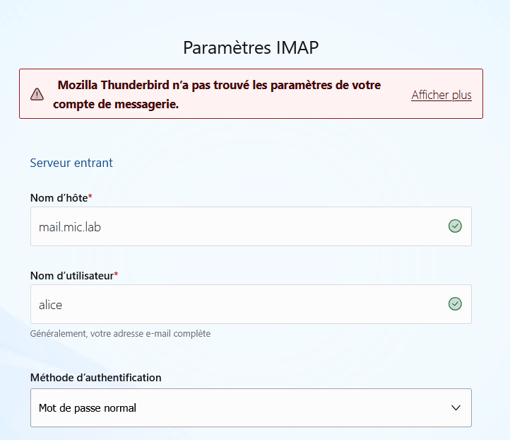
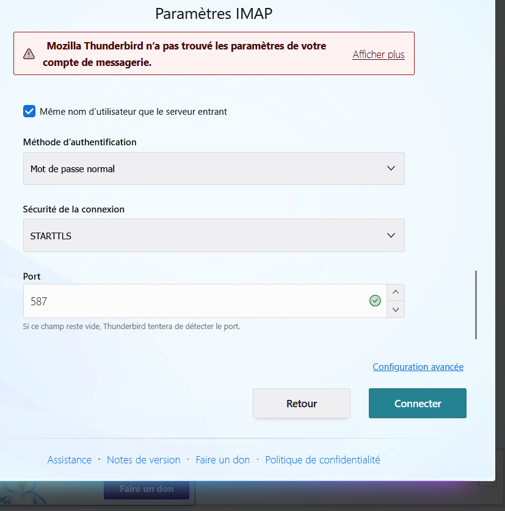

Le bandeau « Thunderbird n'a pas trouvé les paramètres » est normal : `mic.lab` n'existe que dans le labo. Cliquer sur **Configuration avancée** crée le compte sans test.

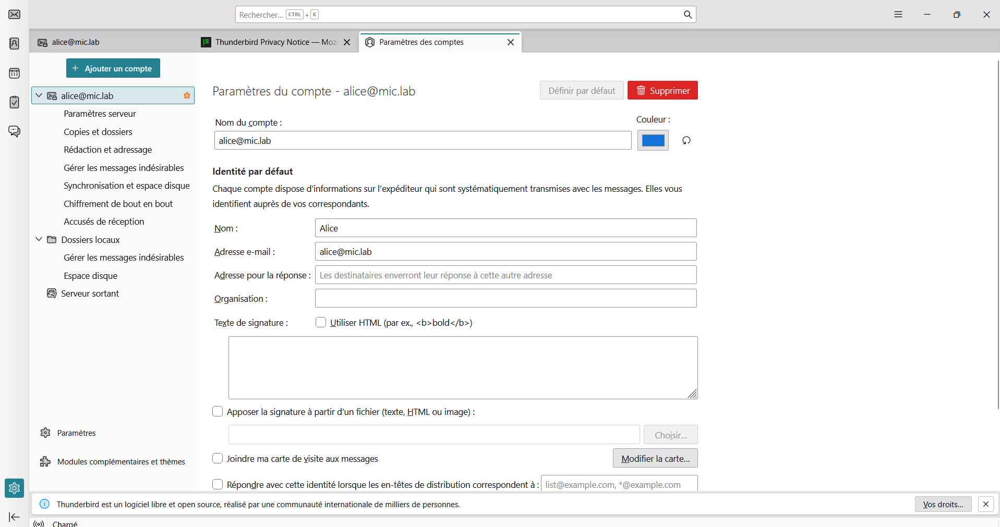

Connexion réussie dans le journal Dovecot :

```
imap-login: Login: user=<alice>, method=PLAIN, rip=192.168.56.1, lip=192.168.56.10, TLS
```

Même chose pour Bob. Échanger quelques mails dans les deux sens.

---

## Partie 5 : la DLP, test sur Windows

```powershell
python tests_dlp.py
python dlp_filter.py --test exemples\04_confidentiel_interne.eml
python dlp_filter.py --test exemples\05_confidentiel_externe.eml
```

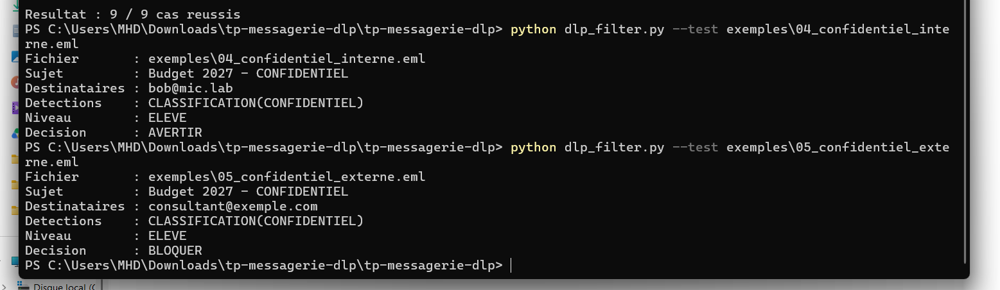

Même contenu, même niveau ÉLEVÉ, mais deux décisions : le destinataire externe n'appartient pas à l'organisation, c'est une **politique contextuelle**.

### Le code en 7 blocs

| Bloc | Rôle |
|---|---|
| 1. Configuration | domaine interne, codes de sortie Postfix (0 OK, 69 refus définitif, 75 réessayer), niveaux, extensions interdites |
| 2. Vérifications | `luhn_valide()`, `iban_valide()` (modulo 97), `masquer()` |
| 3. Règles | expressions régulières (pattern matching) |
| 4. Lecture du mail | sujet, corps, pièces jointes texte, noms de fichiers ; HTML nettoyé |
| 5. Politique | niveau le plus grave + règle interne/externe |
| 6. Actions | journal syslog, en-têtes `X-DLP-*`, réinjection par `sendmail -G -i` |
| 7. Programme principal | **fail-closed** : en cas d'erreur, code 75, le mail reste en file d'attente |

---

## Partie 6 : brancher la DLP sur Postfix

```powershell
scp -r .\tp-messagerie-dlp admin@mail.mic.lab:~/
```

```bash
cd ~/tp-messagerie-dlp && python3 tests_dlp.py
sudo useradd -r -s /sbin/nologin dlpfilter
sudo install -m 755 dlp_filter.py /usr/local/bin/dlp_filter.py
sudo postconf -P "submission/inet/content_filter=dlp:dummy"
# puis ajouter le service "dlp" de config/postfix/master.cf.ajouts à la fin de master.cf
sudo postfix check
sudo postconf -P | grep content_filter
sudo postconf -M dlp/unix
sudo systemctl reload postfix
```

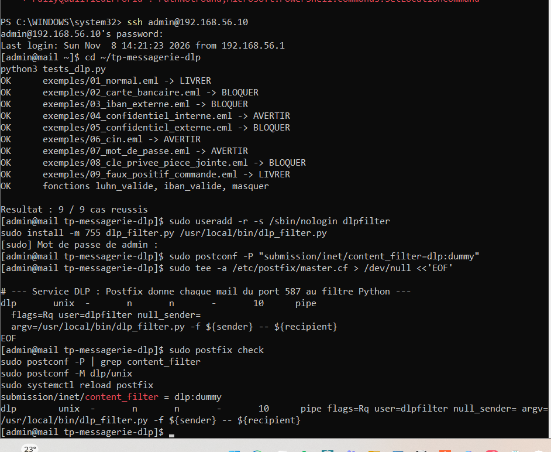

La DLP est placée **uniquement** sur le port 587 : le mail réinjecté par le filtre passe par un autre chemin, il ne repasse donc pas dans le filtre (pas de boucle). SELinux n'a rien bloqué sur AlmaLinux 9.7 ; en cas de problème : `sudo ausearch -m avc -ts recent`.

---

## Partie 7 : scénarios de test

Suivre les décisions en direct : `sudo journalctl -t dlp-filter -f`

| # | De → À | Contenu | Attendu |
|---|---|---|---|
| 1 | alice → bob | « La réunion est décalée à 10h. » | LIVRER |
| 2 | alice → bob | « Voici la carte : 4111 1111 1111 1111 » | BLOQUER (CRITIQUE) |
| 4 | alice → bob | Sujet « Budget 2027 - CONFIDENTIEL » | AVERTIR |
| 5 | alice → consultant@exemple.com | Sujet « Budget 2027 - CONFIDENTIEL » | BLOQUER |
| 7 | alice → bob | « mot de passe : Azerty2026! » | AVERTIR |
| 9 | alice → bob | « Numéro de commande : 1234 5678 9012 3456 » | LIVRER |

`4111 1111 1111 1111` est une carte de test officielle Visa, pas une vraie carte.

Le mail de refus reçu par Alice :

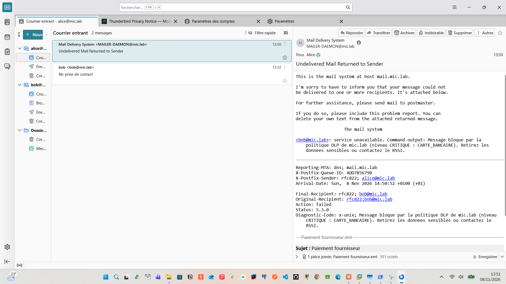

Le journal de la DLP :

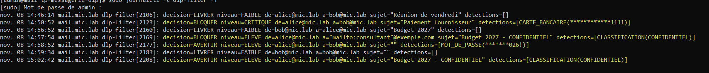

Les en-têtes d'un mail livré (Ctrl+U dans Thunderbird) :

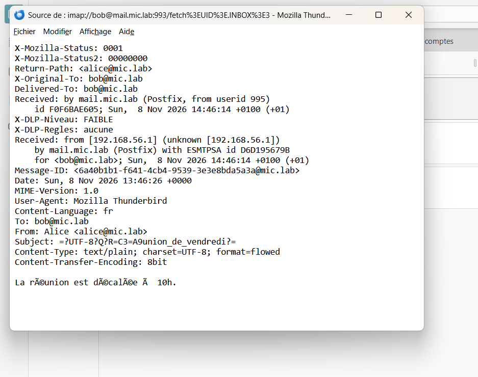

---

## Dépannage

**Toujours lire le journal avant de modifier quoi que ce soit :**

```bash
sudo journalctl -u postfix -u dovecot -f     # en direct
sudo journalctl -t dlp-filter -f             # décisions de la DLP
sudo postqueue -p                            # mails en attente
```

| Symptôme | Ligne du journal | Cause et solution |
|---|---|---|
| Thunderbird ne se connecte pas | `SSL_accept() failed: ssl/tls alert bad certificate: SSL alert number 42` | L'alerte 42 est envoyée par le **client** : Thunderbird rejette le certificat (auto-signé `CA:TRUE`, sans SAN). Créer la PKI (partie 2.1) et importer la CA dans Thunderbird. |
| L'exception de sécurité « n'obtient pas le certificat » | aucune ligne côté Dovecot | la demande n'atteint pas le serveur ; inutile avec la PKI |
| Authentification refusée | `pam_unix(dovecot:auth): authentication failure ... user=alice` | mauvais mot de passe : `sudo passwd alice`, test avec `su - alice`, puis effacer le mot de passe enregistré dans Thunderbird |
| `Relay access denied` | `NOQUEUE: reject: RCPT ... Relay access denied` | envoi sur le port 25 au lieu de 587 |
| Mails bloqués en file avec `relay=dlp` | `status=deferred` | script absent ou non exécutable, ou SELinux : `ls -l /usr/local/bin/dlp_filter.py`, `ausearch -m avc` |
| `bad interpreter` | `/usr/bin/env: 'python3\r'` | fichier enregistré avec des fins de ligne Windows : `sudo sed -i 's/\r$//' /usr/local/bin/dlp_filter.py` |
| `dnf update` échoue | `linux-firmware ... all mirrors were already tried` | `--exclude=linux-firmware*` |
| `nmcli : commande introuvable` | | faute de frappe (`nmclo`) : SSH + copier-coller |

Après une correction : `sudo postfix check`, `sudo systemctl reload postfix`, puis `sudo postqueue -f` pour relancer les mails en attente.
